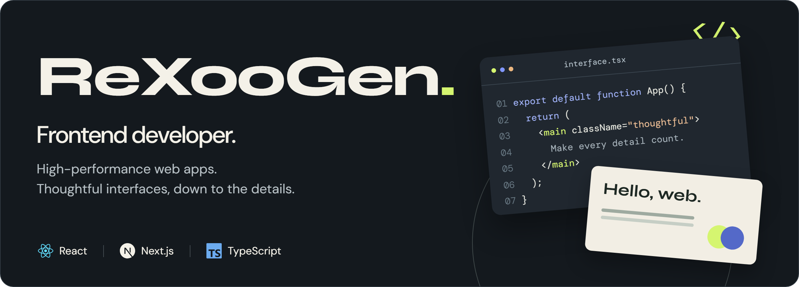
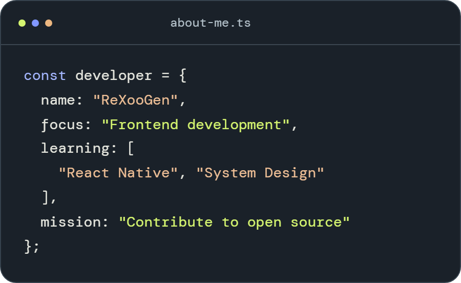
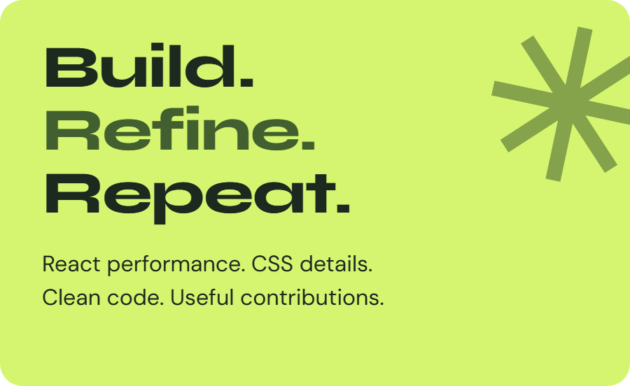
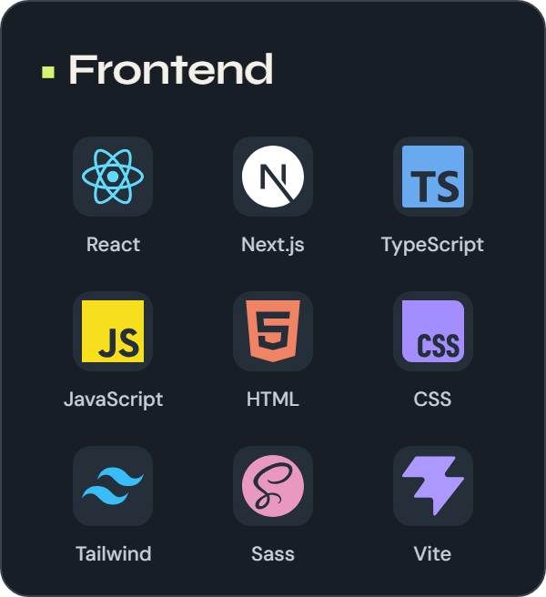
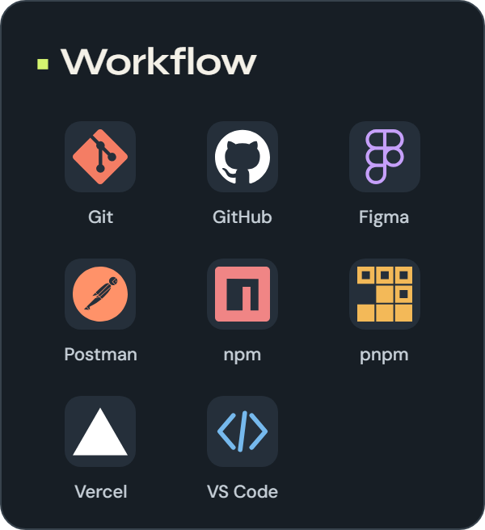
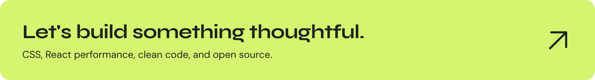

  

  <a href="https://github.com/ReXooGen?tab=repositories"><strong>Explore my repositories</strong></a>
  &nbsp;&nbsp; · &nbsp;&nbsp;
  <a href="https://github.com/ReXooGen?tab=stars">Things I'm exploring</a>

 

## A little about me

I build with **React, Next.js, and TypeScript**, with a focus on fast web apps and the small details that make an interface feel good to use. Right now, I'm exploring **React Native** and **system design**, and looking for useful ways to contribute to open source.

  
  &nbsp;
  

 

## The tools behind the work

From the first Figma layout to the deployed interface.

  
  &nbsp;
  
  &nbsp;
  

 

## One contribution at a time

Learning by building, and giving something back along the way.

<picture>
  <source media="(prefers-color-scheme: dark)" srcset="https://raw.githubusercontent.com/ReXooGen/ReXooGen/output/github-contribution-grid-snake-dark.svg">
  <source media="(prefers-color-scheme: light)" srcset="https://raw.githubusercontent.com/ReXooGen/ReXooGen/output/github-contribution-grid-snake.svg">
  
</picture>

 

  Still debugging with <code>console.log</code>. Still making it better.

